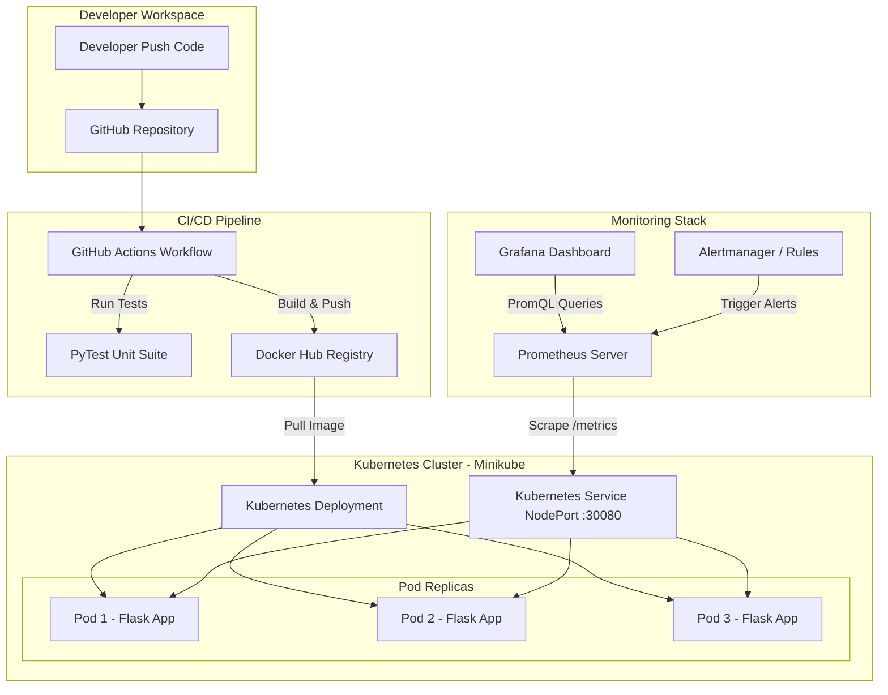

# ContainerPulse: Real-Time Container Deployment and Health Monitoring Platform


---

## 1. Abstract
**ContainerPulse** is an end-to-end cloud-native DevOps platform designed for real-time application deployment, automated container orchestration, health monitoring, self-healing, and continuous integration/continuous delivery (CI/CD). Built with Python Flask, Docker, Kubernetes (Minikube), Prometheus, Grafana, and GitHub Actions, ContainerPulse provides real-time visibility into pod metrics, CPU/memory usage, HTTP request rates, application errors, and cluster resilience.

---

## 2. Introduction
In modern microservices architectures, managing individual container instances manually becomes unmanageable as applications scale. Cloud-native DevOps principles prioritize automation, declarative infrastructure management, continuous monitoring, and automated resilience. ContainerPulse demonstrates how modern DevOps practices converge to build a self-healing, observable infrastructure.

---

## 3. Problem Statement
Manually tracking container status, CPU/memory consumption, application errors, and node health is time-consuming and error-prone. Developers and DevOps engineers face key challenges:
- High mean time to detection (MTTD) and mean time to recovery (MTTR) during pod crashes.
- Difficulty in isolating errors originating from specific container instances.
- Lack of centralized metrics collection and alert notifications for resource saturation.
- Slow manual deployment processes without automated testing and quality gates.

---

## 4. Existing System vs. Proposed System

| Feature | Existing System (Traditional Setup) | Proposed System (ContainerPulse DevOps) |
| :--- | :--- | :--- |
| **Deployment** | Manual script execution on bare metal / VMs | Automated K8s deployment & GitHub Actions CI/CD |
| **Scaling & Resilience** | Manual restart upon server crash | Automated pod self-healing & replica maintenance |
| **Health Checking** | Periodic manual ping or no automated probes | Kubernetes Liveness & Readiness Probes |
| **Monitoring** | Decentralized server logs | Centralized Prometheus metrics collection |
| **Visualization** | Text-based terminal output | Interactive, real-time Grafana dashboards |
| **Alerting** | Passive incident response | Automated threshold alerts (CPU > 80%, HTTP 500) |

---

## 5. Objectives
1. Build a containerized microservice application using Python Flask.
2. Package and run the microservice using Docker containerization.
3. Deploy and orchestrate 3 replicated pods using Kubernetes (Minikube).
4. Demonstrate Kubernetes self-healing when a pod fails or is deleted.
5. Scrape real-time performance and custom metrics using Prometheus.
6. Design an interactive Grafana monitoring dashboard.
7. Automate testing, image building, and deployment using GitHub Actions CI/CD.

---

## 6. System Architecture



---

## 7. Technologies Used
- **Python 3.11 & Flask**: Web application framework.
- **prometheus_client**: Python library for custom Prometheus metrics generation.
- **Docker**: Containerization engine.
- **Kubernetes (Minikube)**: Container orchestration & local cluster environment.
- **Prometheus**: Time-series database & metrics scraper.
- **Grafana**: Real-time visual metrics dashboard.
- **Helm**: Kubernetes package manager for installing monitoring tools.
- **GitHub Actions**: Automated CI/CD execution.

---

## 8. Directory & File Structure

```
ContainerPulse/
├── app/
│   ├── app.py              # Main Flask application with /health, /error, /metrics
│   ├── requirements.txt    # Python dependencies
│   ├── test_app.py         # Pytest unit tests
│   └── Dockerfile          # Docker image build instructions
├── k8s/
│   ├── deployment.yaml     # Kubernetes Deployment (3 replicas, probes, metrics annotations)
│   ├── service.yaml        # Kubernetes NodePort Service
│   └── configmap.yaml      # Environment variables & configuration
├── monitoring/
│   └── prometheus.yaml     # Prometheus configuration & alert rules
├── .github/
│   └── workflows/
│       └── deploy.yml      # GitHub Actions CI/CD pipeline definition
├── README.md               # Project documentation & guide
└── .gitignore              # Files to ignore in Git
```

---

## 9. Step-by-Step Implementation Guide (PowerShell)

### Stage 1: Verify Prerequisites
Open **Windows PowerShell** and run:

```powershell
docker --version
kubectl version --client
minikube version
py --version
git --version
```

*Note: If Helm is not installed, install via Winget:*
```powershell
winget install Helm.Helm
```

### Stage 2: Application Development & Local Test
1. Navigate to the `app` directory:
   ```powershell
   cd ContainerPulse\app
   ```
2. Install dependencies:
   ```powershell
   py -m pip install -r requirements.txt
   ```
3. Execute unit tests:
   ```powershell
   py -m pytest test_app.py -v
   ```
4. Run the Flask application locally:
   ```powershell
   py app.py
   ```
5. Test endpoints in browser or PowerShell:
   - Status: `http://localhost:5000/`
   - Health: `http://localhost:5000/health`
   - Metrics: `http://localhost:5000/metrics`
   - Test Error: `http://localhost:5000/error`

### Stage 3: Docker Containerization
1. Build the Docker image:
   ```powershell
   docker build -t containerpulse:latest ./app
   ```
   *Explanation*: `-t containerpulse:latest` tags the image name. `./app` specifies the build context directory containing the Dockerfile.

2. Run the Docker container locally:
   ```powershell
   docker run -d -p 5000:5000 --name containerpulse-app containerpulse:latest
   ```
   *Explanation*: `-d` runs in detached background mode. `-p 5000:5000` maps host port 5000 to container port 5000.

3. Verify running container & logs:
   ```powershell
   docker ps
   docker logs containerpulse-app
   ```

4. Stop and clean up local container:
   ```powershell
   docker stop containerpulse-app
   docker rm containerpulse-app
   ```

### Stage 4: Kubernetes Deployment on Minikube
1. Start Minikube cluster:
   ```powershell
   minikube start --driver=docker
   ```

2. Point Docker CLI to Minikube's Docker Daemon (or load image):
   ```powershell
   minikube image build -t containerpulse:latest ./app
   ```

3. Apply Kubernetes Manifests:
   ```powershell
   kubectl apply -f k8s/configmap.yaml
   kubectl apply -f k8s/deployment.yaml
   kubectl apply -f k8s/service.yaml
   ```

4. Verify Kubernetes Pods and Service:
   ```powershell
   kubectl get pods -l app=containerpulse
   kubectl get svc containerpulse-service
   ```

5. Access Application URL in Minikube:
   ```powershell
   minikube service containerpulse-service --url
   ```

### Stage 5: Self-Healing Demonstration
1. List active pods:
   ```powershell
   kubectl get pods
   ```
2. Delete one active pod to test automatic recovery:
   ```powershell
   $POD_NAME = (kubectl get pods -l app=containerpulse -o jsonpath='{.items[0].metadata.name}')
   kubectl delete pod $POD_NAME
   ```
3. Watch Kubernetes instantly schedule and launch a replacement pod:
   ```powershell
   kubectl get pods -w
   ```

### Stage 6: Monitoring with Prometheus & Grafana
1. Add Prometheus Helm Repository:
   ```powershell
   helm repo add prometheus-community https://prometheus-community.github.io/helm-charts
   helm repo update
   ```

2. Install Prometheus Stack:
   ```powershell
   helm install prometheus prometheus-community/kube-prometheus-stack
   ```

3. Access Grafana Dashboard:
   ```powershell
   kubectl port-forward svc/prometheus-grafana 3000:80
   ```
   - URL: `http://localhost:3000`
   - Default Username: `admin`
   - Get Password:
     ```powershell
     kubectl get secret prometheus-grafana -o jsonpath="{.data.admin-password}" | [System.Text.Encoding]::UTF8.GetString([System.Convert]::FromBase64String($_))
     ```

---

## 10. Key PromQL Queries for Grafana

| Panel | Metric Description | PromQL Query |
| :--- | :--- | :--- |
| **Running Pods** | Count of active containerpulse pods | `count(kube_pod_status_ready{condition="true", pod=~"containerpulse.*"})` |
| **Total HTTP Requests** | Rate of incoming requests/sec | `sum(rate(containerpulse_http_requests_total[1m]))` |
| **HTTP 500 Error Rate** | Error count per second | `sum(rate(containerpulse_http_500_errors_total[1m]))` |
| **CPU Usage** | Process CPU percentage | `avg(containerpulse_cpu_usage_percent)` |
| **Memory Usage** | Process Memory RSS in MB | `avg(containerpulse_memory_usage_bytes) / 1024 / 1024` |
| **Pod Restarts** | Number of container restarts | `sum(kube_pod_container_status_restarts_total{pod=~"containerpulse.*"})` |
| **App Health Status** | Health Gauge (1=Healthy, 0=Unhealthy) | `min(containerpulse_app_health_status)` |

---

## 11. Testing Matrix

| Test ID | Test Category | Target Endpoint / Action | Expected Result | Pass/Fail |
| :--- | :--- | :--- | :--- | :--- |
| **TC-01** | Unit Test | `test_home_endpoint()` | Returns 200 OK & Hostname | PASS |
| **TC-02** | Unit Test | `test_health_endpoint()` | Returns 200 OK & `"healthy"` | PASS |
| **TC-03** | Unit Test | `test_error_endpoint()` | Returns 500 & error JSON | PASS |
| **TC-04** | Container Test | `docker run containerpulse` | App starts on port 5000 | PASS |
| **TC-05** | K8s Replicas | `kubectl get pods` | Exactly 3 pods in `Running` state | PASS |
| **TC-06** | Self-Healing | `kubectl delete pod <name>` | New pod automatically created | PASS |
| **TC-07** | Metrics | `/metrics` endpoint | Prometheus metrics format output | PASS |
| **TC-08** | Monitoring | Grafana Dashboard | Metrics render live in panels | PASS |
| **TC-09** | CI/CD Pipeline | `git push origin main` | Tests pass & build succeeds | PASS |

---

## 12. Results & Advantages
- **Zero-Downtime Deployment**: 3 replicas ensure high availability.
- **Automated Self-Healing**: Failed pods recover automatically within seconds without human intervention.
- **Observability**: Prometheus & Grafana provide instant detection of traffic spikes, CPU saturation, and application errors.
- **Automated CI/CD**: Quality gates enforce that broken code never reaches production.

---

## 13. Limitations & Future Enhancements
- **Limitations**: Minikube is single-node, suitable for local development/demonstration rather than multi-zone cloud deployments.
- **Future Enhancements**:
  1. Add Horizontal Pod Autoscaler (HPA) to auto-scale replicas based on CPU load.
  2. Implement Service Mesh (Istio) for advanced traffic management and mutual TLS (mTLS).
  3. Integrate Alertmanager to send Slack or email notifications upon high severity alerts.

---

## 14. Conclusion
ContainerPulse successfully demonstrates an enterprise-grade DevOps platform. By combining Python microservices, Docker containerization, Kubernetes orchestration, Prometheus & Grafana observability, and GitHub Actions CI/CD automation, the system achieves real-time container health monitoring, high availability, and automated self-healing.
